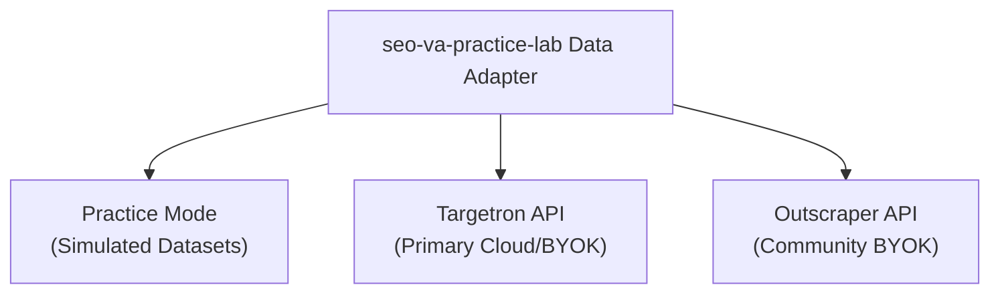

> 💡 **Looking for zero-setup cloud access?** Try the hosted app at [seovapractice.com](https://seovapractice.com) to complete practice assignments and run live research without setting up local API keys.

# SEO VA Practice Lab

Interactive practice lab for **SEO VA Practice**. A hands-on practice environment for learning SEO workflows through realistic simulated assignments.

Instead of only reading about SEO concepts, SEO VA Practice Lab is designed around completing a task, recording your own observations, reviewing the work, and producing a practical deliverable.

> **Current release:** v0.1.0 - First MVP  
> **Current assignment:** Local SEO Competitor Research
> **Current assignment:** Keyword Research + Search Intent  
> **Status:** Live and in active development

## Live Demo

Try the live application:

https://app.seovapractice.com

## Why I Built This

I work in content and SEO, and I am becoming more technically capable by building small projects and documenting what I learn.

SEO VA Practice Lab started with a simple question:

> How can someone practice an SEO workflow before doing the same type of work for a real client?

Many SEO resources explain concepts. This project explores another part of the learning process: practicing the work itself.

The main purpose is not to simulate years of professional experience or replace real client work. It is to provide a safe environment for working through realistic tasks, making decisions, organizing findings, and producing learning artifacts.

## Positioning

**Practice SEO VA work before you have a real client.**

SEO VA Practice Lab is a hands-on learning environment built around realistic simulated assignments, learner-created work, and clear practice artifacts.

Simulated assignments are learning exercises. Completing them does not represent real client experience.

## Architecture

* **app.seovapractice.com** — SEO VA Practice Lab (this repository)
* **seovapractice.com** — Marketing platform, educational guides, and managed API credits

This repository contains the interactive practice lab engine. It can run completely standalone in local development mode.

### Data Adapter & BYOK Model

The lab uses a pluggable adapter pattern to keep simulated practice completely decoupled from live scraping:

* **Simulated Lab Mode (Default):** Practice exercises run entirely on structured local static datasets. Zero setup, zero costs, and no API keys required.
* **Live Research Mode (BYOK):** Bring Your Own Key mode allows learners and agencies to plug in live scraping providers directly in local environment settings.

Supported live data providers:
* **Targetron API (Recommended):** Primary live extraction provider for Google Maps and local business data.
* **Outscraper API:** Community BYOK adapter for local SEO data extraction.



## Current Practice Assignment

### Local SEO Competitor Research

The first assignment simulates a request from an SEO team researching local dental competitors.

The learner receives:

- a simulated client brief
- five fictional dental businesses
- supplied business information
- simulated competitor website profiles
- a defined research deliverable

For each competitor, the learner records:

- services observed
- website observations
- SEO observations
- optional research notes
- research status

An important part of the exercise is separating **supplied data** from **learner research**.

The assignment provides the basic business and website information. The learner is expected to add useful observations rather than simply repeat the supplied data.

## Assignment Workflow

The current application uses a five-step practice workflow:

1. **Client Brief**  
   Understand the client, market, and research request.

2. **Deliverable**  
   Review what information needs to be produced.

3. **Practice Data**  
   Review the businesses supplied for the assignment.

4. **Research**  
   Investigate each competitor and record observations.

5. **Review**  
   Check the completed research before exporting the deliverable.

After Review, the learner can:

- export the research sheet as CSV
- finish the assignment
- return to edit research
- start the assignment over with confirmation

## Current Features

The current version includes:

- guided multi-step assignment workflow
- five fictional practice competitors
- simulated competitor website profiles
- competitor-by-competitor research workspace
- required-field validation
- browser-based progress persistence
- review and edit workflow
- CSV research-sheet export
- assignment completion screen
- confirmed Start Over workflow
- responsive desktop and mobile layouts
- Vercel Web Analytics

## Validation

A competitor cannot be considered complete until the learner has entered:

- Services observed
- Website observation
- SEO observation

Research Notes are optional.

Whitespace-only answers do not satisfy the required fields.

All five competitors must contain valid required research and be marked **Complete** before the learner can continue to Review.

## Browser Persistence

Assignment progress is stored in browser `localStorage`.

The application currently preserves:

- current assignment step
- active competitor
- partial research
- completed research

Refreshing the page does not automatically erase the learner's work.

The **Start Over** workflow includes a separate confirmation screen before saved research is cleared.

Progress is currently browser-specific and is not synchronized between devices.

## Research Sheet Export

Completed research can be exported as:

```text
local-seo-competitor-research.csv```

The CSV combines supplied business information with the learner's research.

The current export includes:

```text
Business Name
Category
Address
City
State
Phone
Website
Rating
Review Count
Business Status
Services Observed
Website Observation
SEO Observation
Research Notes
Research Status
```

## Tech Stack

The current project uses:

- Next.js
- React
- TypeScript
- Tailwind CSS
- JSON practice datasets
- Browser localStorage
- Vercel Web Analytics
- Git
- GitHub
- Vercel

The current MVP does not require a database, user authentication, or an external API.

## Practice Data

The first assignment uses fictional businesses and simulated website information.

The main practice datasets include:

```text
src/data/competitor-practice.json
src/data/competitor-website-profiles.json
```

These datasets exist to support the learning workflow.

They should not be treated as verified real-world business or competitor research.

## Project Structure

A simplified view of the current project:

```text
src/
|-- app/
|   |-- page.tsx
|   `-- assignments/
|       `-- local-seo-competitor-research/
|           |-- page.tsx
|           |-- AssignmentWorkspace.tsx
|           `-- components/
|               |-- AssignmentHeader.tsx
|               |-- AssignmentSidebar.tsx
|               |-- ClientBriefStep.tsx
|               |-- DeliverableStep.tsx
|               |-- PracticeDataStep.tsx
|               |-- ResearchStep.tsx
|               |-- ResearchForm.tsx
|               |-- ResearchStatusControl.tsx
|               |-- ReviewStep.tsx
|               |-- ExportResearchButton.tsx
|               |-- AssignmentComplete.tsx
|               `-- StartOverConfirmation.tsx
|
|-- data/
|   |-- competitor-practice.json
|   `-- competitor-website-profiles.json
|
`-- lib/
    `-- exportCompetitorResearchCsv.ts
```
## Running the Project Locally

Clone the repository:

```bash
git clone https://github.com/edumbao/seo-va-practice-lab.git
```

Move into the project:

```bash
cd seo-va-practice-lab
```

Install dependencies:

```bash
npm install
```

Start the development server:

```bash
npm run dev
```

Then open:

```text
http://localhost:3000
```

## Production Build

Run:

```bash
npm run build
```

The project is deployed on Vercel from the GitHub `main` branch.

Changes pushed to `main` are automatically built and deployed by Vercel after they are committed and pushed to GitHub.

## Analytics

Basic production traffic is measured with Vercel Web Analytics.

The current implementation is intended for basic visitor and page-view monitoring.

Analytics was added after the original `v0.1.0` release and is part of the current `main` branch.

## Current Limitations

This is an early MVP.

Current limitations include:

- only one practice assignment is available
- practice datasets are bundled with the application
- progress is stored only in the current browser
- there are no user accounts
- progress is not synchronized across devices
- the assignment architecture is still partly hard-coded
- automated scoring is intentionally not included
- mobile assignment navigation could be more compact

These limitations are useful boundaries for the current version rather than features that must all be solved immediately.

## Roadmap

The project is intentionally evolving as I learn more about SEO, virtual-assistant workflows, APIs, automation, and technical documentation.

Areas being explored include:

### VA Foundations

- understanding VA work
- choosing VA services
- resume preparation
- application letters
- job application workflows
- client communication
- time and task management

### SEO Practice

- keyword research
- search intent
- content SEO
- on-page SEO
- local SEO
- link building
- technical SEO
- SEO analytics
- SEO auditing

### Tools and Workflows

- Google Sheets
- lead generation
- Apps Script
- APIs
- automation
- reusable practice datasets
- workflow documentation

Future ideas are exploratory and should not be treated as implemented features.

## Longer-Term Direction

The project may eventually evolve into a broader **VA Practice Lab**, with SEO VA Practice becoming one specialization.

A possible structure is:

```text
VA Practice Lab
|
|-- VA Foundations
|-- Career Lab
|-- Work Tools
|-- Workflow Labs
|
`-- Specializations
    |-- SEO VA
    |-- Content VA
    |-- Lead Generation VA
    `-- Technical / Automation VA
```

The working philosophy is:

```text
Learn the workflow
        |
        v
Do the task
        |
        v
Document what happened
        |
        v
Turn the process into an SOP
        |
        v
Convert it into a practice assignment
```

## Learning Project

This repository is also part of my personal technical-writing journey.

I am approaching the project as a content and SEO professional becoming more technically capable through hands-on work.

Building the first MVP has given me practical experience with:

- structuring practice data
- breaking a workflow into UI states
- React component state
- required-field validation
- browser persistence
- CSV generation
- component refactoring
- Git checkpoints
- debugging build problems
- responsive QA
- GitHub releases
- Vercel deployment
- production analytics

The goal is not to present myself as an expert software developer.

The goal is to understand technical workflows well enough to build useful small projects, document them clearly, and connect that knowledge back to SEO and content work.

## Release

The first production-tested MVP is:

**v0.1.0 - First MVP**

Release notes:

https://github.com/edumbao/seo-va-practice-lab/releases/tag/v0.1.0

The `v0.1.0` tag remains the frozen checkpoint for the original production-tested MVP. Development continues on `main`.

## Disclaimer

SEO VA Practice Lab currently uses fictional businesses and simulated practice information.

Assignments are learning exercises and should not be represented as paid client work, verified real-world research, or professional client results.
